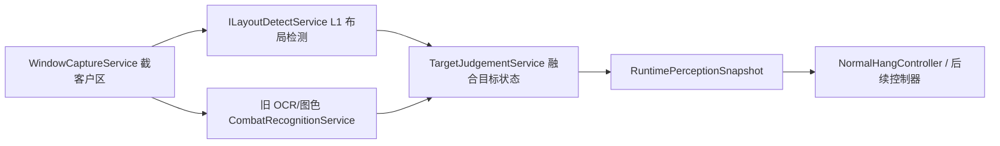

# Vision Perception Integration - 2026-07-09

## 结论

龙伴行开始接入视觉模型架构，但当前 ONNX 产物只能作为 L1 布局检测模型使用：定位 `target_panel`、`target_hp_bar`、`target_name`。它不能直接判断玩家/怪物/BOSS，也不能直接判断死亡；这些仍需要 L2 图色/分类器/旧 OCR 规则补齐。

## 已接入的工程骨架

- `TlbbAgent.Contracts/PerceptionContracts.cs`
  - `RuntimePerceptionSnapshot`
  - `LayoutSnapshot`
  - `TargetPerception`
  - `IPerceptionHub`
  - `ILayoutDetectService`
  - `ITargetJudgementService`
  - `IModelArtifactRegistry`
- `TlbbAgent.Core/Perception/`
  - `ModelArtifactRegistry`
  - `NullLayoutDetectService`
  - `TargetJudgementService`
  - `PerceptionHub`
- DI 已注册以上服务。

## 运行路线



## 当前模型产物

产物目录：

`%USERPROFILE%\Desktop\TLBB 视觉模型\train\artifacts\l1_layout`

文件：

- `layout_detect.onnx`
- `layout_detect.pt`
- `classes.yaml`
- `inference_config.json`
- `TRAIN_REPORT.md`

来源：

- `train/runs/target_p0_yolov8n_abs`
- `train/packages/target_p0_yolo_reviewed`

验证快照：

- all: P=0.995, R=1.000, mAP50=0.995, mAP50-95=0.814
- target_panel: P=0.993, R=1.000, mAP50=0.995, mAP50-95=0.976
- target_hp_bar: P=0.998, R=1.000, mAP50=0.995, mAP50-95=0.788
- target_name: P=0.993, R=1.000, mAP50=0.995, mAP50-95=0.678

## 不能误用的边界

当前 L1 模型不提供：

- `target_kind=player/monster/boss`
- `hp_state=empty/full/mid/low`
- 玩家保护最终判定
- 打死换怪最终判定

因此 `NormalHangController` 暂不切换到 ONNX 作为唯一依据。正确做法是：

1. ONNX 先给出目标面板和血条 ROI。
2. L2 对 `target_hp_bar` 做图色百分比和空血判断。
3. L2/模板/采样分类器判断玩家、宠物、怪物、BOSS。
4. `RuntimePerceptionSnapshot` 成熟后再替换控制器里的直接 OCR 依赖。

## L2 OpenText（2026-07-10 已接入插槽）

| 项 | 说明 |
|----|------|
| 契约 | `IOpenTextRecognizer` / `OpenTextSlot` / `OpenTextResult` |
| 实现 | `RapidOcrOpenTextRecognizer` → 常驻 Python worker `tools/opentext_worker/opentext_worker.py`（RapidOCR/PP-OCR） |
| 产物目录 | `Desktop/TLBB 视觉模型/train/artifacts/l2_opentext/` |
| 挂载点 | `PerceptionHub.Read`：裁目标名条 → OpenText → 写入 `Target.NameText` / `TargetNameOpenText` |
| 策略 | **开放读字符串**；类型映射（可打/保护等）后续用 policy JSON，不进模型类别 |
| 纠错 | 离线：多样本批跑 → 人工改错 → 再微调；**不挡**当前插槽接入 |

### 2026-07-10 实测结果

- 修复了 Windows 子进程中文编码：worker 统一返回 ASCII 转义 JSON，C# 解析后得到正确中文。
- worker 改为常驻进程，RapidOCR 只加载一次；不再每次识别都启动 Python。
- 真实 fixture `target_000438.png`：L1 目标名框裁图后，L2 正确识别 `徐欣`。
- 常驻进程冷启动约 `816ms`；热识别 `p50=101ms`、`p95=211ms`。
- L1 fixture `5/5` 通过；目标血量插槽 fixture `9/9` 通过。
- 血量插槽连续两帧确认空槽后才输出 `DeadByHpBottom`；控制器只把融合后的 `0%` 当确认死亡，`1–5%` 仍按存活目标持续攻击。

验证命令：

```powershell
& 'C:\Program Files\dotnet\dotnet.exe' run --project tools\TlbbAgent.VisionHarness\TlbbAgent.VisionHarness.csproj -c Release --no-build
```

环境：

- `TLBB_AGENT_PYTHON`：Python 路径（默认本机 Python313）
- `TLBB_AGENT_VISION_ARTIFACTS`：视觉产物根目录（含 `l1_layout` / `l2_opentext`）
- 依赖：`pip install rapidocr_onnxruntime`

## 下一步

1. 增加 ONNX Runtime 推理适配器，实现 `ILayoutDetectService` 的真实推理。
2. 写离线 fixture 测试：输入 `train/test` 图片，输出检测框叠图和 JSON。
3. 增加 `TargetHpBarMeter`：只在 L1 给出的血条框内做图色生命状态。
4. 继续标注/训练目标分类器：玩家、宠物、怪物、BOSS、精英。
5. 将 `NormalHangController` 的读状态入口迁移为 `IPerceptionHub.Read`。
6. OpenText：积累 crop 真值 → 微调 `opentext_rec.onnx` 替换 Python worker；ContentPolicy 映射类型。
